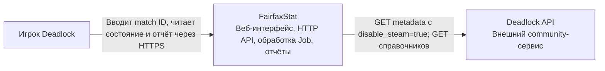
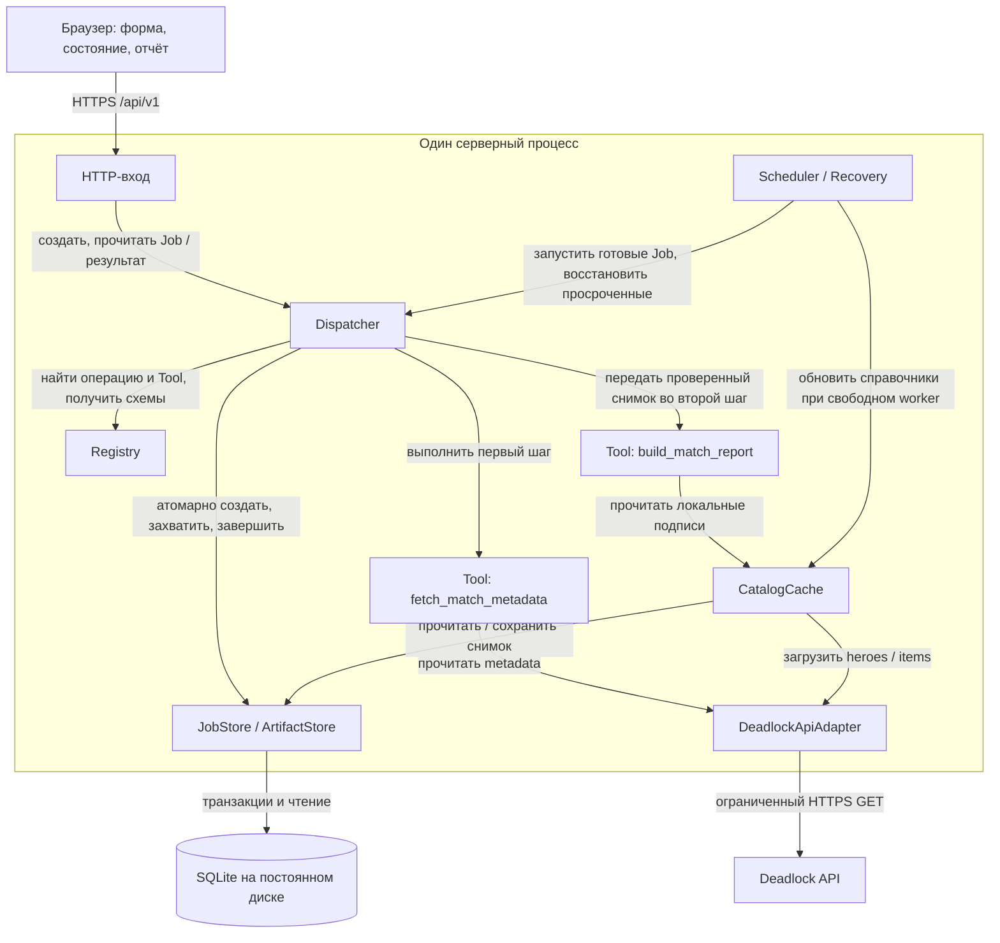

# Архитектура FairfaxStat

Дата: 15 ноября 2026 года. Версия: 1.

Сервис принимает ID завершённого матча, создаёт фоновый Job и строит отчёт по доступным metadata. Он продолжает сценарии С1–С5 практики 1: пять состояний Job, до трёх попыток, сохранение результата, предупреждения о неполных данных. Прямое подключение к Steam / Game Coordinator, разбор replay, сбор всех матчей, аккаунты и отмена Job в первую версию не входят.

## Контекст

**Стрелки показывают взаимодействия во время работы:** пользователь обращается к системе, система вызывает внешний API. Ответы идут по тем же соединениям и отдельными стрелками не показаны. Это контекст системы, а не зависимости кода. Deadlock API — сторонний сервис, не официальный REST API Valve; прямого соединения нашего приложения с Valve нет.

## Компоненты

**Стрелки показывают вызовы, а не импорт модулей:** подпись обозначает запрос инициатора к получателю. Возвращаемые значения не показаны. Dispatcher передаёт выход первого Tool второму; прямого вызова между Tool нет. Работа с SQLite скрыта за Store; Tool не меняют состояние Job. Registry хранит описания и ссылки на локальные Tool, но сам их не запускает.

| Компонент | Ответственность и что скрывает от соседей |
|---|---|
| Браузер | Принимает ID и показывает Job/отчёт; скрывает форму, навигацию, polling и хранение клиентского секрета. |
| HTTP-вход | Проверяет транспорт, авторизацию, размер и JSON, выдаёт единые ошибки; скрывает HTTP-заголовки, сериализацию и маршрутизацию. |
| Dispatcher | Проверяет операцию и параметры, управляет Job и последовательностью Tool; скрывает порядок шагов и условия переходов. |
| Registry | Сопоставляет `analyze_match` с двумя версиями Tool и их схемами; скрывает классы реализации и способ их регистрации. |
| Scheduler / Recovery | Находит готовые задания и потерянных владельцев; скрывает период опроса, расписание повторов и восстановления. |
| `fetch_match_metadata` | Получает и проверяет минимальные данные матча; скрывает структуру ответа источника и правила выделения обязательных полей. |
| `build_match_report` | Преобразует проверенный снимок в отчёт; скрывает разбор событий, рядов, координат и независимую проверку дополнительных блоков. |
| DeadlockApiAdapter | Выполняет ограниченные GET на фиксированный хост и классифицирует сетевые отказы; скрывает HTTP-клиент, TLS, таймауты и заголовки источника. |
| CatalogCache | Даёт снимок подписей героев/предметов либо отсутствие подписи; скрывает загрузку, срок свежести и хранение справочника. |
| JobStore / ArtifactStore | Сохраняет Job, ключи и артефакты с проверкой владельца попытки; скрывает SQL, блокировки и транзакции SQLite. |
| SQLite | Даёт постоянное транзакционное хранение; скрывает размещение страниц, журнал и восстановление прерванных транзакций. |

## Основной путь

1. Браузер сохраняет анонимный секрет клиента и отдельный `Idempotency-Key` этой отправки. Это не Steam login и не учётная запись.
2. HTTP-вход принимает `POST /api/v1/jobs`. Dispatcher проверяет `operation=analyze_match`, нормализует строковый `match_id` и ищет ключ в области клиента.
3. Одна транзакция создаёт Job в `queued` и привязку ключа. Ответ `202` содержит сохранённый Job и `Location`. Повтор эквивалентного запроса возвращает `200` и прежний Job в его текущем состоянии.
4. Scheduler опрашивает очередь раз в секунду. Dispatcher атомарно переводит один Job в `running`, увеличивает `attempts` и получает новый `run_token`.
5. Registry выбирает `fetch_match_metadata@1`, затем `build_match_report@1`. Каждый шаг либо возвращает типизированный результат, либо ошибку из [контракта Tool](tool-contract.md).
6. После проверки обоих результатов Store одной транзакцией сохраняет исходный снимок, отчёт и `succeeded`. До commit отчёт недоступен.
7. Браузер читает `GET /api/v1/jobs/{job_id}`; при успехе — `GET /api/v1/jobs/{job_id}/result`. Рекомендуемый интервал polling — 2 секунды. Ошибка HTTP при polling не означает `failed` самого Job.

## Хранение и восстановление

SQLite содержит Job, привязки ключей, готовые исходные снимки и отчёты, а также кеш справочников. Очередь — выборка Job из этой же БД, отдельного брокера нет. JSON хранится в БД, поэтому публикация отчёта и `succeeded` входят в один commit. Неполный ответ источника и неуспешный результат Tool не становятся опубликованными артефактами.

Job хранит `job_id`, хеш секрета клиента, `operation`, нормализованный `match_id`, `state`, `attempts`, даты, `next_attempt_at`, `error`, `last_error`, версии Tool, а также внутренние `run_token` и `lease_until`. Клиент не получает хеш секрета и поля владения. Уникальность ключа задаётся парой «хеш секрета клиента, Idempotency-Key».

У попытки фиксированный lease 90 секунд и общий срок выполнения 60 секунд. Продления lease в первой версии нет. Любая запись результата требует совпадения `run_token`, `state=running`, неистёкшего lease и срока попытки. Recovery проверяет просроченные lease при старте и каждые 5 секунд. Бюджет попыток хранится в БД и не сбрасывается после перезапуска; детали — в [автомате Job](job-lifecycle.md#recovery).

Если БД недоступна, сервис не подтверждает создание и не начинает новые попытки. HTTP возвращает `503 STORAGE_UNAVAILABLE`. При неопределённом исходе commit клиент повторяет запрос с тем же ключом: существование Job нельзя определить по потере ответа. После восстановления БД штатный Recovery разбирает зависшие `running`. Повреждение диска и восстановление из резервной копии требуют действий оператора; автоматическое восстановление из потери всей БД не обещается.

## Внешняя зависимость и пределы

| Ограничение первой версии | Правило |
|---|---|
| Внешний источник | Только `https://api.deadlock-api.com`; metadata с `disable_steam=true`; редиректы запрещены. |
| Параллелизм | Один активный Job; справочники обновляются тем же worker только при отсутствии готового Job. |
| Вход POST | Не более 8 192 байт UTF-8; вложенность JSON до 8; сжатые тела не принимаются. |
| Очередь | Не более 100 незавершённых Job суммарно; новый запрос сверх лимита получает `503 QUEUE_FULL`. Повтор уже принятого ключа обслуживается до этой проверки. |
| Получение metadata | Один GET на попытку; до 30 секунд на соединение и чтение вместе; до 32 MiB после распаковки, глубина JSON до 64. |
| Подготовка отчёта | До 20 секунд; весь Job-attempt до 60 секунд; отчёт до 16 MiB UTF-8. |
| Повторы | До 3 попыток; базовые задержки 5 и 30 секунд; учитывается `Retry-After`, предел ожидания 120 секунд. |
| Справочники | Снимок обновляется не чаще раза в сутки; один GET каждого справочника до 10 секунд и 16 MiB, без автоматических повторов. Ошибка оставляет прежний кеш или числовые ID. |
| Хранение | Job, результаты и ключи не удаляются автоматически в v1; секрет и ключ не попадают в логи. |

Это выбранные ограничения нашего сервиса, не обещания внешнего API. Для очереди 100 означает число Job в `queued`, `running`, `retry_wait`; проверка и вставка выполняются в одной транзакции. Запросы источника повторяет только Dispatcher. Вложенные повторы в HTTP-клиенте и Tool отключены.

## Решения и источники

- [ADR-0001: один процесс и локальные Tool](adr/0001-single-process.md).
- [ADR-0002: постоянная очередь и атомарный результат](adr/0002-durable-jobs.md).
- [ADR-0003: идентичность клиента и отправки](adr/0003-request-identity.md).
- [ADR-0004: неизменяемое завершение и отсутствие отмены](adr/0004-no-cancellation.md).
- [OpenAPI нашего сервиса](api/openapi.yaml), [правила HTTP](api/README.md), [проверка К1–К10](contract-check.md).

Внешние сведения сверены с [OpenAPI Deadlock API](https://api.deadlock-api.com/openapi.json) 15 ноября 2026 года: metadata запрашиваются по `/v1/matches/{match_id}/metadata`; параметр `disable_steam` отключает Steam fallback. Наличие ответа 200 не гарантирует корректность каждого дополнительного блока. Формат нашего контракта основан на [OpenAPI 3.1.0](https://spec.openapis.org/oas/v3.1.0).
