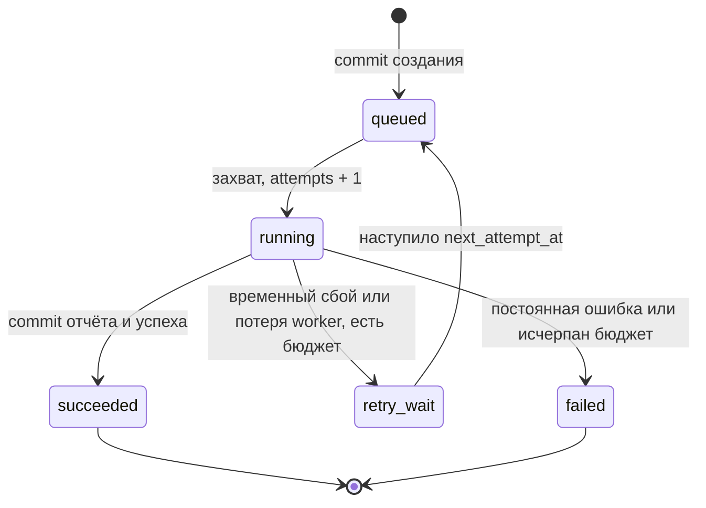

# Состояния Job
## Диаграмма

Стрелки — разрешённые изменения сохранённого состояния, не вызовы и не зависимости кода. `[*]` обозначает создание/конец автомата и не входит в значения `state`. Перехода из терминального состояния обратно в начало нет.

| Состояние | Смысл и обязательные поля |
|---|---|
| `queued` | Сохранён и ожидает worker; `attempts` 0–2, `error=null`, `next_attempt_at=null`. |
| `running` | Есть действующий владелец; `attempts` 1–3, `error=null`, `next_attempt_at=null`; внутренние token/lease обязательны. |
| `retry_wait` | Ожидает ограниченный повтор; `attempts` 1–2, `error=null`, `last_error` и `next_attempt_at` заполнены. |
| `succeeded` | Готовый отчёт сохранён; `attempts` 1–3, `error=null`, `next_attempt_at=null`, `finished_at` и `result_url` заполнены. |
| `failed` | Выполнение окончено без отчёта; `attempts` 1–3, `error` и `finished_at` заполнены, `result_url=null`, `next_attempt_at=null`. |

`last_error` хранит последнюю причину временного отказа и может остаться после успешного повтора; интерфейс не выдаёт её за текущую ошибку. `error` заполнен только в `failed`. Для остальных состояний `finished_at=null`; для всех, кроме `succeeded`, `result_url=null`.

## Разрешённые переходы

| Откуда → куда | Инициатор и условие | Атомарное изменение |
|---|---|---|
| Создание → `queued` | Dispatcher: запрос валиден, ключ новый, очередь не заполнена | Job + ключ, `attempts=0`; только после commit — HTTP 202. |
| `queued → running` | Dispatcher: свободен worker, `attempts<3`, версии Tool зафиксированы в Job | Увеличить `attempts`, задать новый `run_token`, deadline +60 с и lease +90 с. |
| `running → succeeded` | Текущий владелец: срок не истёк, валиден весь обязательный результат | Сохранить исходный снимок, отчёт и успех одной транзакцией. |
| `running → retry_wait` | Текущий владелец: повторяемая ошибка, `attempts<3`, ожидание ≤120 с | Сохранить `last_error`, `next_attempt_at`, убрать владение. |
| `retry_wait → queued` | Scheduler: время БД ≥ `next_attempt_at` | Очистить время повтора; счётчик попыток не менять. |
| `running → failed` | Текущий владелец: постоянная ошибка, исчерпан бюджет или ожидание >120 с | Сохранить `error`, `finished_at`, убрать владение, не публиковать отчёт. |
| Просроченный `running → retry_wait` | Recovery: lease истёк, `attempts<3` | `last_error.code=WORKER_LOST`, повтор через 5 с; прежний token недействителен. |
| Просроченный `running → failed` | Recovery: lease истёк, `attempts=3` | `error.code=WORKER_LOST`, время завершения; без четвёртой попытки. |

Для недоступной сохранённой версии Tool worker сначала захватывает Job, затем завершает его `TOOL_VERSION_UNAVAILABLE`: переход `queued → failed` не добавляется. Версии уже принятых Job не подменяются новыми при релизе.

После deadline попытки публикация успеха запрещена. До истечения lease текущий владелец ещё может записать `failed PROCESSING_TIMEOUT`; после истечения lease действует только Recovery. Ошибка `WORKER_LOST` имеет `retryable=true`, но третья потеря worker всё равно завершает Job без автоматического повтора.

## Запрещённые переходы

В таблице перечислены **все пары** пяти состояний. `—` означает отсутствие перехода: читать состояние можно, повторно входить в него нельзя. Обновление служебных данных без изменения состояния не считается переходом.

| Из / в | `queued` | `running` | `retry_wait` | `succeeded` | `failed` |
|---|---|---|---|---|---|
| `queued` | — | Разрешён с захватом | Запрещён | Запрещён | Запрещён |
| `running` | Запрещён | — | Разрешён с условиями | Разрешён с commit | Разрешён с причиной |
| `retry_wait` | Разрешён по времени | Запрещён | — | Запрещён | Запрещён |
| `succeeded` | Запрещён | Запрещён | Запрещён | — | Запрещён |
| `failed` | Запрещён | Запрещён | Запрещён | Запрещён | — |

Даже разрешённая пара запрещена при невыполненных условиях. Store возвращает внутренний `INVALID_JOB_TRANSITION` без изменения записи; при устаревшем token или lease — `STALE_ATTEMPT`. Это внутренние ошибки управления, не новые состояния и не причина портить уже сохранённый Job. Дубликат завершения ничего не переписывает. Dispatcher фиксирует событие в журнале без секретов; клиент читает фактическое состояние.

В публичном API нет операции установки `state`. Ответы на попытки клиента определены отдельно от ошибок Store:

| Попытка | HTTP и тело | Что происходит с Job |
|---|---|---|
| `PATCH`, `PUT`, `POST` или `DELETE /api/v1/jobs/{job_id}` | `405 METHOD_NOT_ALLOWED`, `details[0].field=method`, `Allow: GET` | Ничего, независимо от существования id. |
| `POST /api/v1/jobs/{job_id}/cancel` или `/restart` | `404 ROUTE_NOT_FOUND`, `details[0].field=path` | Этих маршрутов нет; Job не ищется. |
| Передать `state`, `attempts` или `job_id` в `POST /jobs` | `400 VALIDATION_ERROR`, поле `/state`, `/attempts` или `/job_id` | Job не создаётся; лишние свойства запрещены. |
| Повторить завершённый запрос с прежним ключом и телом | `200`, прежний Job в `succeeded`/`failed` | Новый запуск не происходит. |
| Осознанно повторить анализ с новым ключом | `202`, новый Job | Старый результат и ошибка неизменны. |

Формат всех HTTP-ошибок — [ErrorEnvelope в OpenAPI](api/openapi.yaml), правила маршрутизации — [HTTP-контракт](api/README.md#routing).

## Повторы и время

Одна попытка — один захват `queued → running` и не более одного GET metadata. Ошибка после загрузки не запускает новый сетевой запрос внутри той же попытки. Временные сетевые ошибки, timeout и HTTP 429/500/502/503 допускают повтор; остальные исходы перечислены в [таблице Tool](tool-contract.md#source-errors).

После попыток 1 и 2 базовая задержка равна 5 и 30 секундам. Если `Retry-After` корректен, фактическая задержка — максимум базовой задержки и значения заголовка. Delta-seconds отсчитывается от получения ответа; HTTP-date переводится в UTC, прошедшая дата даёт нулевой минимум. Невалидный заголовок игнорируется. Округление вверх до целой секунды исключает ранний запрос. При ожидании ровно 120 секунд повтор допустим, при большем — `failed SOURCE_RATE_LIMITED`, `error.retry_at` содержит время, после которого можно попробовать новый Job.

На третьей временной ошибке Job сразу завершается: `SOURCE_RATE_LIMITED` для 429, `SOURCE_UNAVAILABLE` для сетевой ошибки, timeout или 500/502/503. `error.retry_at` сохраняется, если источник дал корректное время. Поле `retryable` говорит, имеет ли смысл новый запрос позднее, и не обещает автоматический повтор терминального Job. При `retry_wait` используется `last_error.retryable=true`; `next_attempt_at` всегда заполнено.

Таймаут запроса metadata — 30 секунд целиком, подготовки отчёта — 20 секунд, всей попытки — 60 секунд. Локальное превышение времени даёт `PROCESSING_TIMEOUT` без автоматического повтора. HTTP 504 источника даёт отдельный `SOURCE_QUERY_TIMEOUT` и тоже не повторяется. Часы для lease и расписания берутся из одного серверного источника времени БД; клиентские часы не участвуют.

## Перезапуск и гонки

- При старте сохранённые `queued` остаются в очереди, `retry_wait` ждут своего срока, терминальные Job не меняются.
- Непросроченный `running` не захватывается заново, даже если процесс только что перезапустился. Recovery ждёт `lease_until`; после его истечения выполняет переход из таблицы, обычно в течение следующих 5 секунд при работающей БД.
- При конкуренции Recovery и старого worker выигрывает одна транзакция. Старая попытка без действующего token не публикует результат, даже если HTTP-ответ источника пришёл позднее.
- Сбой до commit результата оставляет Job без опубликованного отчёта. После восстановления возможен повтор чтения внешнего API. Сбой после commit оставляет `succeeded` с одним доступным отчётом.
- Увеличение `attempts`, token и lease фиксируются вместе. Падение сразу после захвата расходует попытку. Повтор никогда не сбрасывает счётчик и не создаёт новый `job_id`.

Гарантия — не более одного опубликованного результата на Job. Ровно одно физическое выполнение Tool или ровно один внешний GET при сбоях не гарантируются. Tool выполняют только чтение внешнего источника, поэтому повтор не создаёт внешних объектов.
